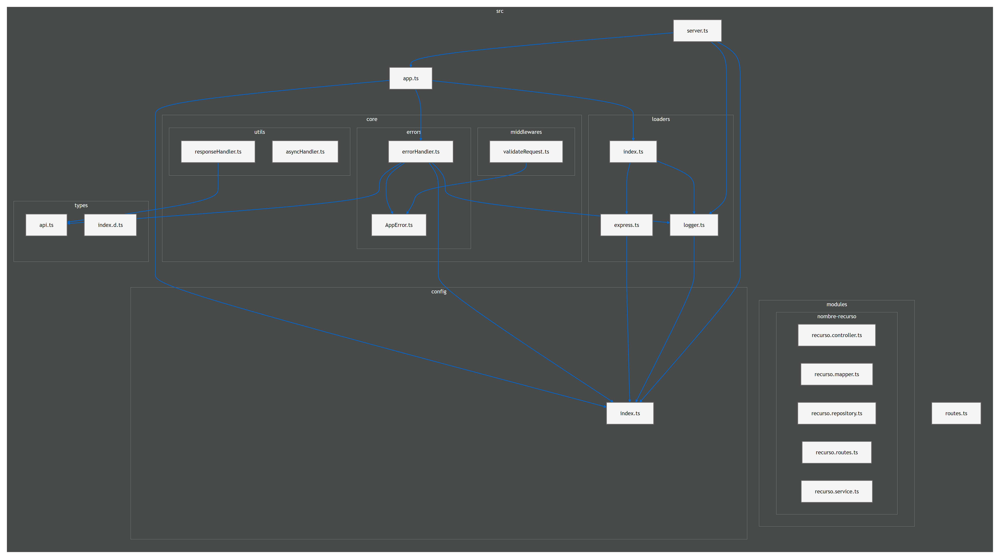


# Starter Template Node.js Express + TypeScript

Para este template, se utilizaron como base las siguientes guías y mejores prácticas de arquitectura:
- [Node.js Express Documentation](https://expressjs.com/en/5x/starter/installing/)
- [Creating an Express.js Project Starter Template - Medium](https://medium.com/@roshithprakash7/creating-an-express-js-project-starter-template-62c4fd6f427d)

La documentación y la industria recomiendan utilizar **TypeScript** para garantizar la seguridad de tipos y mejorar la mantenibilidad. Se añadió el archivo `tsconfig.json` optimizado para resolver alias de rutas y trabajar con módulos nativos ECMAScript (ESM) propias de javascript, existe commonjs pero es antiguo.

---

## Características de Express

Express es un framework de Node.js **no prescriptivo**, lo que significa que no impone una forma específica de estructurar la aplicación ni dicta cómo escribir el código. Sabiendo esto, diseñamos este *starter template* con una arquitectura desacoplada, escalable y lista para diversos entornos.

---

## Estructura del Proyecto

Organizamos el código mediante una **arquitectura modular en 3 capas** (Controller, Service, Repository) con la siguiente distribución de archivos:

```text
src/
├── app.ts                  # Instancia e integración de Express (monta /api-docs y las rutas)
├── routes.ts               # Enrutador central de la API (bajo API_PREFIX)
├── server.ts               # Arranque del servidor HTTP y Graceful Shutdown
├── config/
│   ├── index.ts            # Variables de entorno tipadas y centralizadas
│   └── database.ts         # Conexión PostgreSQL (pg-promise)
├── loaders/
│   ├── express.ts          # Middlewares de seguridad (Helmet, CORS, Rate Limit)
│   ├── index.ts            # Orquestador de inicializadores
│   └── logger.ts           # Pino: consola y, opcionalmente, archivo (LOG_FILE)
├── core/
│   ├── errors/
│   │   ├── AppError.ts     # Clase de error operacional personalizada
│   │   └── errorHandler.ts # Middleware global de errores (4 parámetros)
│   ├── middlewares/
│   │   ├── swaggerAuth.ts  # Basic Auth para /api-docs (env)
│   │   └── validateRequest.ts # Validación DTO con Zod
│   └── utils/
│       ├── asyncHandler.ts # Wrapper para controladores asíncronos
│       └── responseHandler.ts # Respuestas de éxito estandarizadas (sendSuccess)
├── modules/
│   ├── ping/               # Ejemplo mínimo (GET /api/ping): copiarlo para crear un módulo nuevo
│   └── [recurso]/          # Módulos por dominio de negocio
│       ├── recurso.controller.ts
│       ├── recurso.mapper.ts     # Mapeo de Entidades a DTOs
│       ├── recurso.repository.ts # Consultas SQL / Acceso a datos
│       ├── recurso.routes.ts
│       ├── recurso.schema.ts     # Validaciones y tipos de Zod
│       └── recurso.service.ts
└── types/
    ├── api.ts              # Tipos globales de respuestas (ApiSuccessResponse / ApiErrorResponse)
    └── index.d.ts
```

### Diagrama de dependencias

Relaciones de importación entre los archivos de `src/`:



---

## Componentes Reutilizables del Template

1. **Patrón Loaders (`src/loaders/`)**:
   Desacopla la inicialización de la base de datos, el logger y los middlewares de Express para evitar que `app.ts` se convierta en un archivo monolítico.

2. **Cierre Controlado**:
   El servidor en `server.ts` escucha las señales del sistema (`SIGTERM`, `SIGINT`) para completar las peticiones en curso y cerrar las conexiones a bases de datos de manera limpia antes de apagar el proceso.

3. **Manejo Centralizado de Errores**:
   - `AppError`: Clase personalizada para distinguir errores operacionales (400, 401, 404) de fallos inesperados del sistema (500).
   - `errorHandler`: Middleware global que captura cualquier excepción y responde con un formato JSON unificado sin filtrar *stack traces* en producción.

4. **Validación de Entradas (Zod)**:
   Middleware reutilizable (`validateRequest`) que intercepta `body`, `query` y `params`, valida los datos en tiempo de ejecución y retorna un reporte estructurado de errores en caso de fallo.

5. **Respuestas API Homogéneas**:
   Todas las respuestas de la API siguen la estructura encriptada por el tipo `ApiResponse<T>`, evitando valores nulos innecesarios gracias a uniones discriminadas (`success: true | false`).

6. **Control de Asincronía (`asyncHandler`)**:
   Wrapper para funciones asíncronas en controladores que redirige errores automáticamente al manejador global, evitando bloques `try/catch` repetitivos.

---

## Solución de Errores Comunes y Módulos ESM

Si se sigue la documentación básica de Express al trabajar con sintaxis `import/export`, un error clásico al hacer `node src/app.js` es:

```text
Make sure to set "type": "module" in the nearest package.json file or use the .mjs extension.
```

Para solucionarlo:
- Se añadió `"type": "module"` en el `package.json` para activar **ES Modules (ESM)** de forma nativa en Node.js.
- Para el desarrollo con alias de rutas (`@core/*`, `@modules/*`, etc.), utilizamos **`tsx`**, el ejecutor más rápido para TypeScript con soporte nativo de ESM.
- Requiere Node.js 20 o superior (CI y Docker usan 22).
- Para la compilación a producción, usamos **`tsc-alias`**, el cual traduce automáticamente los alias `@` a rutas relativas dentro de la carpeta `dist/`.

---

## Paquetes Principales

- [express](https://www.npmjs.com/package/express): Framework web minimalista.
- [pino](https://www.npmjs.com/package/pino) & [pino-pretty](https://www.npmjs.com/package/pino-pretty): Logging estructurado en JSON de alto rendimiento.
- [dotenv](https://www.npmjs.com/package/dotenv): Carga de variables de entorno.
- [cors](https://www.npmjs.com/package/cors): Habilitación de CORS con políticas de origen.
- [helmet](https://www.npmjs.com/package/helmet): Protección mediante cabeceras HTTP seguras.
- [express-rate-limit](https://www.npmjs.com/package/express-rate-limit): Prevención de ataques de fuerza bruta y abuso de la API.
- [zod](https://www.npmjs.com/package/zod): Validación de esquemas e inferencia de tipos estáticos.
- [swagger-autogen](https://www.npmjs.com/package/swagger-autogen) & [swagger-ui-express](https://www.npmjs.com/package/swagger-ui-express): Generación y visualización de la documentación OpenAPI.
- [tsx](https://www.npmjs.com/package/tsx): Ejecución ultrarrápida de TypeScript en modo desarrollo.
- [tsc-alias](https://www.npmjs.com/package/tsc-alias): Resolución de alias de rutas en el proceso de compilación (`build`).

---

## Scripts Disponibles

En la raíz del proyecto puedes ejecutar:

```bash
# Iniciar servidor en modo desarrollo con recarga automática
npm run dev

# Verificar tipos sin generar archivos (lo mismo que corre el CI)
npm run typecheck

# Compilar el proyecto TypeScript a JavaScript en /dist
npm run build

# Iniciar la aplicación compilada en entorno de producción
npm start

# Limpiar la carpeta dist
npm run clean

# Generar swagger-output.json (documentación OpenAPI) a partir de src/routes.ts
npm run swagger
```

---

## Variables de entorno

Copiar `.env.example` a `.env` y ajustar. Todo se lee en un solo lugar (`src/config/index.ts`), incluida la documentación Swagger.

| Variable | Default | Descripción |
|----------|---------|-------------|
| `PORT` | `3000` | Puerto del servidor. También define la URL que muestra Swagger |
| `NODE_ENV` | `development` | `development` usa logs legibles (pino-pretty) y expone el stack en errores |
| `API_PREFIX` | `/api` | Prefijo donde se montan las rutas. También sale en Swagger |
| `LOG_LEVEL` | `info` | `fatal`, `error`, `warn`, `info`, `debug`, `trace` |
| `LOG_FILE` | *(vacío)* | Si se define (ej: `logs/app.log`) los logs también se escriben en ese archivo en JSON. Vacío = solo consola |
| `DB_HOST` `DB_PORT` `DB_USER` `DB_PASSWORD` `DB_NAME` | ver `.env.example` | Conexión a PostgreSQL |
| `DB_REQUIRED` | `true` solo en `production` | Si es `true` y la BD no responde, el servidor no arranca |
| `SWAGGER_USER` / `SWAGGER_PASSWORD` | *(vacío)* | Credenciales de `/api-docs`. Sin ambas la ruta no se monta |
| `SWAGGER_TITLE` `SWAGGER_DESCRIPTION` `SWAGGER_VERSION` | ver `.env.example` | Datos que muestra la documentación |
| `SWAGGER_SERVER_URL` | `http://localhost:$PORT$API_PREFIX` | Solo para pisar la URL (ej: dominio público) |

---

## Documentación de la API (Swagger / OpenAPI)

Se genera con [swagger-autogen](https://www.npmjs.com/package/swagger-autogen) y se expone en una sola ruta, `/api-docs`, protegida con Basic Auth.

1. Definir `SWAGGER_USER` y `SWAGGER_PASSWORD` en el `.env`.
2. Generar los paths: `npm run swagger` (volver a correrlo cada vez que cambien las rutas).
3. Levantar el servidor y entrar a `http://localhost:<PORT>/api-docs`.

4. Probar los endpoints: en `/api-docs` abrir un endpoint, Try it out y Execute. El template trae `GET /api/ping` para ver cómo se documenta.

Para documentar un endpoint nuevo: registrar el módulo en `src/routes.ts` y poner los comentarios `// #swagger.tags = [...]`, `// #swagger.summary = '...'` dentro del handler en el archivo de rutas (como en `src/modules/ping/ping.routes.ts`); `swagger-autogen` no lee los comentarios que estén en los controllers.

### Comportamiento

- Los *paths* salen de `swagger-output.json`; el título, la versión y el servidor (`PORT` + `API_PREFIX`) se toman del `.env` en cada arranque, así que cambiar el puerto no requiere regenerar el archivo.
- Si falta `SWAGGER_USER`/`SWAGGER_PASSWORD` o `swagger-output.json`, la ruta no se monta (cerrada por defecto) y se avisa en el log.
- La autenticación está en `src/core/middlewares/swaggerAuth.ts` y compara las credenciales en tiempo constante.
- Basic Auth envía la clave en base64 (no cifrada): fuera de localhost usarlo detrás de HTTPS.

---

## Logs

Por defecto salen por consola (pino-pretty en `development`, JSON en el resto). Para guardarlos además en un archivo definir `LOG_FILE`:

```env
LOG_FILE=logs/app.log
```

La carpeta se crea sola y `logs/` está en `.gitignore` y `.dockerignore`.

---

## Flujo de ramas y CI

Ramas fijas, de menor a mayor estabilidad:

| Rama | Para qué sirve | Cuándo se toca |
|------|----------------|----------------|
| `desarrollo` | Integración del trabajo diario | Todo el desarrollo: se crean ramas `feature/*` o `fix/*` desde acá y se vuelven por PR |
| `stage` | Pre-producción / QA | Cuando `desarrollo` tiene un conjunto de cambios listo para probar: PR `desarrollo` → `stage`. Acá solo se corrigen bugs que aparezcan en QA |
| `produccion` | Lo que está desplegado | Cuando `stage` fue validado: PR `stage` → `produccion` (etiquetar la versión, ej: `v1.2.0`) |

```text
feature/* ──PR──> desarrollo ──PR──> stage ──PR──> produccion
```

- Nadie hace commit directo en `stage` ni `produccion`; solo llegan cambios por PR.
- Un bug urgente en producción se corrige en una rama `hotfix/*` desde `produccion`, y luego se vuelve a llevar a `stage` y `desarrollo` para no perder el arreglo.
- El workflow [`.github/workflows/ci.yml`](.github/workflows/ci.yml) corre en cada PR y push a esas tres ramas: `typecheck`, `build`, `npm run swagger` y `npm audit` de dependencias de producción (Node 22). Falta agregar el paso de tests cuando exista un runner.
- Recomendado en GitHub (Settings → Branches): proteger `stage` y `produccion` exigiendo PR y que pase el check `build`, y poner `desarrollo` como rama por defecto.

---

## Fuentes y Referencias

- [Software on the Road - Una arquitectura a prueba de balas para proyectos Node.js](https://softwareontheroad.com/es/ideal-nodejs-project-structure)
- [DEV Community - Architecting Scalable and Maintainable Node.js Applications](https://dev.to/jefersoneiji/architecting-scalable-and-maintainable-nodejs-applications-best-practices-and-examples-o16)
```